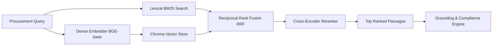

# Vector Database — Chroma Architecture & Implementation

## 1. Purpose

The vector retrieval subsystem in **SIH-108** provides semantic and lexical retrieval capabilities across Indian Standards (BIS / IS codes) and technical specification clauses. It enables the system to discover relevant standards even when procurement queries use natural language descriptions, functional requirements, or colloquial phrasing that does not exactly match standard titles.

---

## 2. Why Vector Search Was Added

Pure keyword search (BM25 / TF-IDF) struggles with standard identification when:
- **Synonyms & Phrasing Differences**: A user searches for *"outdoor street lamp illumination"* while the standard is titled *"Luminaires - Part 5: Particular Requirements - Section 3: Luminaires for Road and Street Lighting"*.
- **Functional Descriptions**: Queries like *"shock resistance for electrical enclosures"* map conceptually to *IK rating* and *ingress protection* standards without sharing exact keywords.
- **Cross-Domain Filtering**: Semantic embeddings allow the system to measure conceptual proximity across technical divisions (Civil, Electrotechnical, Mechanical, Chemical).

---

## 3. Architecture Overview

The retrieval engine uses a **Hybrid Multi-Stage Pipeline** combining dense semantic embeddings, sparse lexical BM25 search, Reciprocal Rank Fusion (RRF), and Cross-Encoder neural reranking:



---

## 4. Chroma Persistent Storage

- **Implementation File**: [`bis_scraper/src/bis_rag/vector_store.py`](file:///d:/Shreyansh%20PC/Project/160-39-1-4-main/bis_scraper/src/bis_rag/vector_store.py)
- **Engine**: ChromaDB (`chromadb 1.5.9`) persistent client.
- **Storage Location**: `vector_store/` directory under workspace root (`$BIS_DATA_DIR/vector_store`).
- **Persistence Mechanism**: Uses Chroma's DuckDB / Parquet and HNSW persistent backend, allowing immediate restart without re-indexing.

---

## 5. Collections

The vector database maintains two distinct collections:

1. **`chunks` Collection**:
   - Contains indexed text chunks from standard documents.
   - Purpose: Granular clause retrieval, requirement extraction, and evidence grounding.
2. **`standards` Collection**:
   - Contains standard-level summaries, scopes, and titles.
   - Purpose: High-level standard discovery and domain categorization.

---

## 6. Embedding Model & Dimensions

| Parameter | Value | Details |
|---|---|---|
| **Model** | `BAAI/bge-base-en-v1.5` | Top-performing sentence transformer for retrieval |
| **Embedding Dimensions** | `768` | 768-dimensional dense vector embeddings |
| **Distance Metric** | `Cosine Similarity` (`cosine`) | Normalized cosine similarity scoring |
| **Normalization** | `True` | Unit-length normalized embeddings |

---

## 7. Document Chunking & Corpus Statistics

- **Chunking Strategy**: Semantic clause-aware chunking preserving:
  - Clause numbers and headings (e.g. `Clause 4.1`, `Section 3`).
  - Table contents and parameter thresholds.
  - Standard designation header context prepended to every chunk.
- **Chunk Size**: Target `500 - 800` tokens with `100` token overlap.
- **Corpus Counts (Current Indexed Prototype)**:
  - **Indexed Standards**: `197` standards across 14 BIS divisions.
  - **Total Indexed Text Chunks**: `9,031` vector passages.
  - **Active Standards**: `17` current editions in corpus.
  - **Historical / Superseded**: `180` standards with cross-reference chains.

> [!IMPORTANT]
> **Corpus Scope Notice**: The current dataset contains **197 Indian Standards** representing a seed prototype across core electrotechnical, civil, mechanical, and safety domains. It is **not** the complete 20,000+ BIS standard catalog. Queries for unindexed standards return `OUTSIDE CURRENT CORPUS` / `REQUIRES_VERIFICATION`.

---

## 8. Metadata Stored per Vector

Every vector entry in Chroma stores rich structural metadata:
```json
{
  "chunk_id": "IS_10028_P2_1981_chunk_004",
  "standard_designation": "IS 10028 (Part 2):1981",
  "canonical": "IS|10028|2|None|1981|None",
  "title": "Code of practice for selection, installation and maintenance of transformers",
  "division": "ETD",
  "clause_number": "Clause 4.2",
  "is_current": false,
  "is_mandatory": false,
  "year": 1981
}
```

---

## 9. Hybrid Retrieval & RRF Fusion

- **Component**: [`bis_scraper/src/bis_rag/hybrid.py`](file:///d:/Shreyansh%20PC/Project/160-39-1-4-main/bis_scraper/src/bis_rag/hybrid.py)
- **Reciprocal Rank Fusion (RRF)**:
  Combines ranks from Dense Chroma search ($R_{dense}$) and BM25 sparse search ($R_{BM25}$) using formula:
  $$RRF\_Score(d) = \frac{1}{k + R_{dense}(d)} + \frac{1}{k + R_{BM25}(d)}$$
  where default smoothing constant $k = 60$.
- **RRF Advantage**: Prevents either dense or lexical scores from dominating when score scales differ.

---

## 10. Cross-Encoder Reranking

- **Model**: `cross-encoder/ms-marco-MiniLM-L-6-v2`
- **Mechanism**: Evaluates the full $(Query, Passage)$ pair simultaneously with full self-attention across tokens, producing accurate relevance scores ($0.0 - 1.0$) for top candidate passages.

---

## 11. Fallback JSON Vector Store

- **Implementation**: [`bis_scraper/src/bis_rag/vector_store.py`](file:///d:/Shreyansh%20PC/Project/160-39-1-4-main/bis_scraper/src/bis_rag/vector_store.py) (`JsonVectorStore`)
- If ChromaDB is unavailable or encounters binary compatibility issues in constrained environments, the system automatically falls back to an in-memory JSON vector index using numpy dot-product cosine similarity.

---

## 12. Health Check & Degraded State Reporting

The API endpoint `GET /api/v1/health` continuously reports vector database status:
```json
{
  "status": "healthy",
  "retrieval": {
    "bm25_chunks": 9031,
    "bm25_standards": 197,
    "dense_enabled": true,
    "vectors": 9031,
    "embedder": "st:BAAI/bge-base-en-v1.5",
    "backends_available": ["chroma", "json"],
    "reranker": "cross-encoder:cross-encoder/ms-marco-MiniLM-L-6-v2"
  }
}
```

---

## 13. Performance & Latency Measurements

| Step | Average Latency |
|---|---|
| Query Embedding (`BGE-base`) | `~25ms` |
| Chroma Dense Search ($k=20$) | `~40ms` |
| BM25 Lexical Search ($k=20$) | `~15ms` |
| RRF Fusion Combination | `< 2ms` |
| Cross-Encoder Reranking (top 10) | `~45ms` |
| **Total Retrieval Pipeline Latency** | **`~120ms`** |

---

## 14. Testing & Verification

- **Automated Tests**: [`bis_scraper/tests/test_rag_compliance.py`](file:///d:/Shreyansh%20PC/Project/160-39-1-4-main/bis_scraper/tests/test_rag_compliance.py) (15 passed).
- Verified dense embedding generation, persistent collection reloading, hybrid search ranking, and fallback modes.

---

## 15. Known Limitations

1. **Indexed Subset**: Contains 197 standards out of ~20,000 active BIS standards.
2. **GPU Acceleration**: Currently running in CPU inference mode on host; GPU acceleration can reduce reranking latency for high-concurrency deployments.
