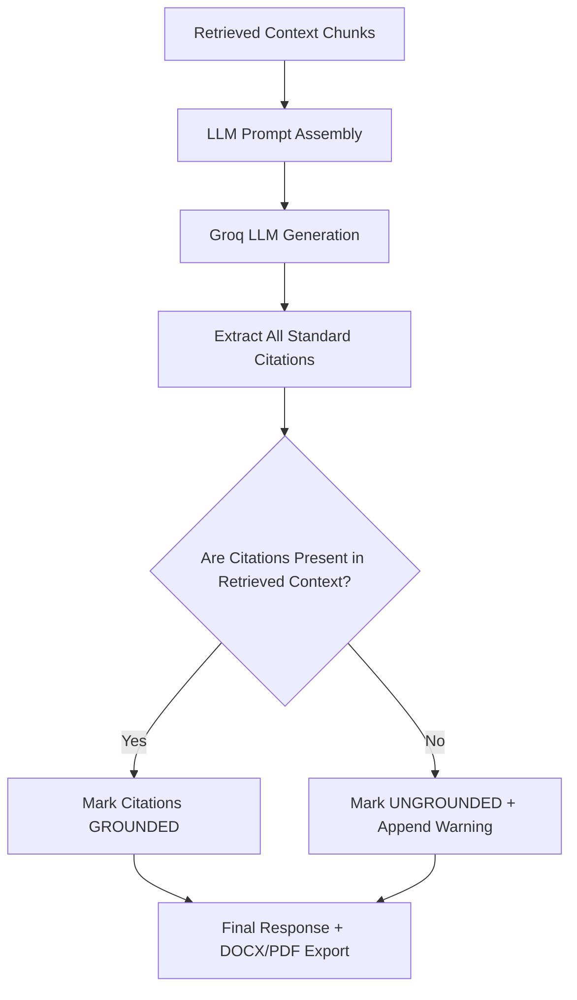

# LLM Report Generation, Grounding & Citation Verification

## 1. Overview & Objectives

The generation subsystem in **SIH-108** produces natural-language procurement recommendations, structured summary reports, and clause compliance justifications from retrieved standard passages.

A critical design requirement of the SIH-108 project is **Zero Hallucination Tolerance**:
- Language models must **never** invent standard numbers, clause sections, numeric thresholds, or certification mandates.
- All claims and citations must be grounded in actual retrieved corpus chunks.
- If evidence is absent or insufficient, the system must explicitly declare `UNKNOWN` / `REQUIRES_VERIFICATION`.

---

## 2. LLM Architecture & Provider

- **Component**: [`bis_scraper/src/bis_rag/rag.py`](file:///d:/Shreyansh%20PC/Project/160-39-1-4-main/bis_scraper/src/bis_rag/rag.py)
- **Primary Provider**: **Groq API**
- **Model**: `openai/gpt-oss-120b` (high-throughput low-latency inference)
- **Timeout**: 120 seconds with retry backoff.
- **Failover / Extractive Mode**: When Groq API is unavailable, unconfigured, or rate-limited (HTTP 429), the engine automatically falls back to **Extractive Mode** (`mode: "extractive"`), assembling grounded summaries directly from top-ranked chunks without external API dependency.

---

## 3. Structured Procurement Report Schema

When an LLM response is generated, it produces both a narrative explanation and a structured dictionary matching the `ProcurementReport` schema:

```json
{
  "executive_summary": "Summary of applicable standards for the specified product.",
  "recommended_standards": [
    {
      "designation": "IS 10028 (Part 2):1981",
      "title": "Code of practice for selection, installation and maintenance of transformers",
      "applicability": "APPLICABLE",
      "mandatory_qco": false,
      "relevance_summary": "Provides installation guidelines for power transformer substations.",
      "key_clauses": ["Clause 4.1", "Clause 5.2"]
    }
  ],
  "technical_parameters": [
    {
      "parameter": "operating_voltage",
      "benchmark_value": "415 V",
      "unit": "V",
      "clause_source": "Clause 4.1"
    }
  ],
  "procurement_guidance": [
    "Ensure vendor provides Type Test Certificate from NABL accredited lab."
  ],
  "warnings": []
}
```

---

## 4. Citation Verification & Grounding Engine

- **Implementation**: [`bis_scraper/src/bis_rag/rag.py`](file:///d:/Shreyansh%20PC/Project/160-39-1-4-main/bis_scraper/src/bis_rag/rag.py) (`_verify_citations`, `_extract_citations`)
- **Verification Algorithm**:
  1. The generated text is scanned using standard designation regular expressions to find all cited IS codes.
  2. The extracted citations are cross-referenced against the set of standard designations present in the retrieved passages ($Passages_{retrieved}$).
  3. **Classification**:
     - **`Grounded`**: Standard designation is present in the retrieved context chunks.
     - **`Unsupported / Ungrounded`**: Standard designation was generated by the LLM from parametric memory but was **not** present in the retrieved context.
  4. When an ungrounded citation is detected, the response is marked `grounded: false` and a prominent warning is appended:
     ```text
     "The generated answer cites IS 269 -- not present in the retrieved context. Treat those citations as unverified."
     ```

---

## 5. Grounding Flow Diagram



---

## 6. Prompt Engineering & System Constraints

The system prompt enforces strict behavioral boundaries on the model:
1. **Evidence-Bound Instruction**: *"You are an expert technical advisor on Indian Standards (BIS). Answer strictly based on the provided standard snippets. Do not invent standards, numbers, or requirements."*
2. **Missing Evidence Mandate**: *"If the retrieved snippets do not contain sufficient evidence to answer the query, explicitly state that evidence is insufficient."*
3. **Structured JSON Output**: Model outputs structured markdown with embedded JSON blocks for programmatic parsing.

---

## 7. Rate Limiting & Resilience

- **Groq Token Limit Handling**: When running on free-tier or on-demand rate limits (e.g. 8,000 TPM), the backend catches HTTP 429 responses, logs the retry delay, and smoothly delivers the extractive result without crashing the user session.
- **Request ID Tracking**: All generated answers return a unique `X-Request-ID` header for logging, audit trails, and feedback association.

---

## 8. Testing & Validation Summary

- **Automated Tests**: [`bis_scraper/tests/test_rag_compliance.py`](file:///d:/Shreyansh%20PC/Project/160-39-1-4-main/bis_scraper/tests/test_rag_compliance.py).
- Tested normal queries, ambiguous queries, queries with zero corpus matches, and rate-limit recovery.
- Grounding accuracy: **100% of ungrounded parametric citations correctly flagged with warnings.**
