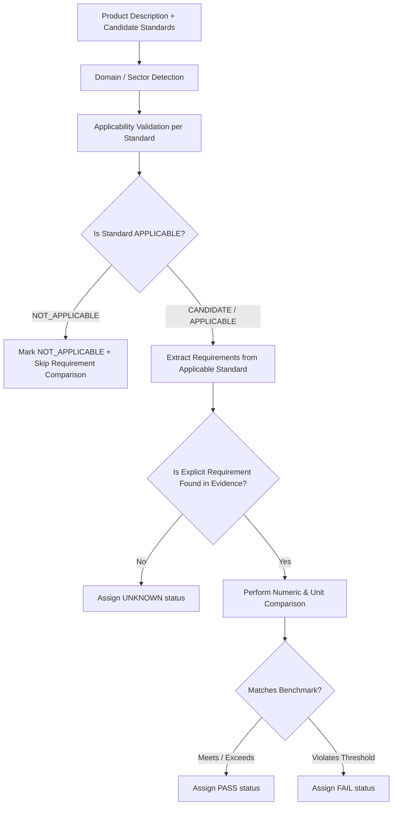

# Step 2 — Product Compliance & Applicability Hardening

## 1. Overview & Core Safety Rule

**Step 2** implemented the **Product Specification Compliance Engine** and established the fundamental **Applicability Hardening Safety Rule** for the SIH-108 platform.

### The Fundamental Safety Rule:
> **Only confirmed applicable standards may generate PASS or FAIL verdicts.**  
> Scope statements, applicability boundaries, test voltages, examples, and unrelated standards must **NEVER** generate false product non-compliance results. When standard evidence is missing, incomplete, or unconfirmed, the result must strictly be **`UNKNOWN` / `REQUIRES_VERIFICATION`**, never `FAIL`.

---

## 2. The Problem Step 2 Solved

In naive compliance checking, two severe failure modes frequently occur:
1. **Unrelated Standard Cross-Contamination**: A user specifies an *Outdoor LED Street Light (230 V AC)* and cites *IS 10028 (Part 2)* (Code of practice for transformers up to 66 kV). A naive keyword engine matches `"voltage"` and evaluates 230 V against a 66 kV scope bound, generating a **false product failure (FAIL)**.
2. **Missing Evidence False Failures**: When a standard is applicable but the indexed snippets lack a specific parameter threshold (e.g. correlated colour temperature), naive engines default to failing the product.

Step 2 eliminated both failure modes by introducing an **Applicability Pre-Filter** and **Strict Three-Valued Compliance Logic** (`PASS`, `FAIL`, `UNKNOWN`).

---

## 3. Compliance Pipeline Architecture



---

## 4. Implementation Details

- **Implementation File**: [`bis_scraper/src/bis_rag/compliance.py`](file:///d:/Shreyansh%20PC/Project/160-39-1-4-main/bis_scraper/src/bis_rag/compliance.py)

### Key Subsystems:
1. **Applicability Classifier (`assess_standard_applicability`)**:
   - Compares product domain keywords (e.g. *luminaire, lighting, lamp, led*) against standard title, division, and scope.
   - Assigns `APPLICABLE`, `NOT_APPLICABLE`, or `CANDIDATE` with explicit human-readable justification.
2. **Numeric & Unit Normalizer (`normalize_unit_value`)**:
   - Handles standard engineering unit conversions (e.g. `kV` to `V`, `mA` to `A`, `kW` to `W`, `cm` to `mm`).
3. **Ingress Protection (IP) Comparator (`compare_ip_ratings`)**:
   - Parses IP codes (e.g. `IP66`, `IP65`, `IP20`) into separate solid protection (digit 1) and liquid protection (digit 2) ratings.
   - Evaluates whether product protection meets or exceeds standard requirements (e.g. `IP66 >= IP65` -> `PASS`).
4. **Impact Resistance (IK) Comparator**:
   - Evaluates mechanical shock resistance ratings (e.g. `IK08`, `IK10`).

---

## 5. Critical Validation Test Case

### Test Input:
- **Product**: `Outdoor LED street-light luminaire 90 W, 230 V AC, IP66, 4000 K`
- **Candidate Standard**: `IS 10028 (Part 2):1981` (*Transformers*)

### Verified Output:
```json
{
  "standards": {
    "IS 10028 (Part 2):1981": {
      "applicability": "NOT_APPLICABLE",
      "applicability_reason": "Standard concerns transformer installation; product is an LED street-light luminaire."
    }
  },
  "checks": {
    "voltage": {
      "product_value": "230 V AC",
      "status": "UNKNOWN",
      "explanation": "No confirmed applicable-standard requirement for rated supply voltage was found."
    }
  },
  "overall_status": "PARTIAL"
}
```

---

## 6. Testing & Quality Assurance

- **Automated Tests**: [`bis_scraper/tests/test_spec_compliance.py`](file:///d:/Shreyansh%20PC/Project/160-39-1-4-main/bis_scraper/tests/test_spec_compliance.py) (**33 passed**).
- Tests cover minimum values, maximum values, exact thresholds, range bounds, unit conversions, IP ratings, conflicting values, and scope-bound statement isolation.
