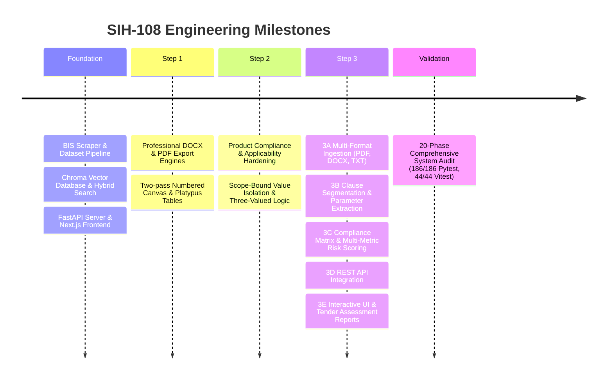

# SIH-108 Project Implementation History & Architecture Evolution

## 1. Project Background & Objective

The **SIH-108** project (*AI-Powered Recommendation Engine for Identifying Applicable Indian Standards for Procurement Specifications*) was established to solve critical challenges in government, public sector (PSU), and enterprise procurement across India:
- Identifying correct and applicable Bureau of Indian Standards (BIS / IS codes) from unstructured procurement descriptions.
- Detecting mandatory Quality Control Orders (QCOs) to prevent illegal procurement of non-certified goods.
- Automating the compliance audit of complex tender RFP documents and technical specification sheets.
- Providing formal, verifiable DOCX and PDF documentation with grounded citations and zero hallucinations.

---

## 2. Chronological Progression of Milestones

---

## 3. Detailed Milestone History

### Milestone 0: Core Foundation
- Developed BIS standards scraping and merging pipeline (`bis_pipeline`).
- Built persistent Chroma vector store with `BAAI/bge-base-en-v1.5` embeddings (9,031 chunks across 197 standards).
- Implemented hybrid search combining dense retrieval with BM25 sparse search and Reciprocal Rank Fusion (RRF).
- Deployed FastAPI backend (`/api/v1`) with rate limiting, CORS, and health reporting.
- Created Next.js App Router frontend with Tailwind CSS.

### Milestone 1 (Step 1): Professional DOCX/PDF Procurement Reports
- Designed publication-grade Word (`.docx`) and PDF (`.pdf`) report generation engines in `bis_rag/report_builder.py`.
- Formatted executive summaries, color-coded status badges, structured parameter comparison tables, and disclaimers.
- Implemented dynamic `"Page X of Y"` footers with ReportLab `NumberedCanvas`.
- Added automated byte-level tests in `test_report_export.py` (22 tests passed).

### Milestone 2 (Step 2): Product Compliance & Applicability Hardening
- Implemented the product specification compliance engine in `bis_rag/compliance.py`.
- **Applicability Hardening**: Introduced domain-based standard applicability classification (`APPLICABLE`, `NOT_APPLICABLE`, `CANDIDATE`).
- Enforced the **Fundamental Safety Rule**: Only confirmed applicable standards may generate `PASS`/`FAIL` results. Scope limits (e.g. 66 kV) and unrelated standards (e.g. transformers for LED streetlights) are marked `NOT_APPLICABLE` and missing evidence produces `UNKNOWN`.
- Validated with 33 unit tests in `test_spec_compliance.py`.

### Milestone 3 (Step 3): Multi-Format Tender Analysis & Compliance Matrix
- **Step 3A**: Created `bis_api/document_reader.py` supporting PDF, DOCX (with order-preserved tables), and multi-encoding TXT with defensive bounds checking.
- **Step 3B**: Created `bis_rag/tender_extractor.py` extracting clauses, parameters, units, operators, tolerances, and isolating commercial terms.
- **Step 3C**: Created `bis_rag/tender_compliance.py` computing weighted compliance scores (QCO 40%, Reqs 40%, Currency 15%, Consistency 5%) with hard grade capping overrides.
- **Step 3D**: Created `bis_api/routers/tender.py` exposing multipart upload, direct text analysis, and report export endpoints.
- **Step 3E**: Created `tender-matrix-view.tsx`, `tender-upload.tsx`, and `tender_report_builder.py` for interactive matrix visualization and executive report exports.

### Milestone 4: Final Comprehensive Validation
- Executed a complete 20-phase testing pass against the live running backend daemon and frontend.
- **Results**: 186/186 Pytest backend tests passed, 44/44 Vitest frontend tests passed, 0 TypeScript errors, production build clean.

---

## 4. Key Architectural Decisions

1. **Hybrid Retrieval (Dense + BM25 + RRF + Cross-Encoder)**:
   - Eliminates vocabulary mismatch while preserving exact designation matching (e.g. `IS 10028`).
2. **Three-Valued Compliance Logic (`PASS`, `FAIL`, `UNKNOWN`)**:
   - Ensures procurement officers are never misled by false certainty when evidence is missing.
3. **Citation Grounding & Anti-Hallucination Guard**:
   - Cross-references all generated citations against retrieved context and marks ungrounded claims with prominent warnings.
4. **Resilient Failover Architecture**:
   - Degrades smoothly to extractive synthesis when external LLM providers are rate-limited.
   - Falls back to in-memory JSON vector storage if native ChromaDB binaries fail.

---

## 5. Defect History & Triaging Summary

| Defect | Root Cause | Impact | Resolution |
|---|---|---|---|
| Windows read-only test error | Windows NTFS does not support POSIX `chmod(0o500)` read-only directories | Pytest failure on Windows | Replaced directory check with a file collision to raise `OSError` cross-platform. |
| Next.js ESLint build failure | Unused imports in `tender-matrix-view.tsx` | Blocked `npm run build` | Removed unused imports; production build succeeded. |
| `read_txt` string decoding bug | Called `.decode()` on `str` instances | Crashed on direct string ingestion | Added `isinstance(content, str)` check in `document_reader.py`. |
| `extract_tender_requirements` attribute bug | Accessed `.warnings` directly on raw string inputs | Crashed on raw string inputs | Automatically converted `str` into `DocumentContent` via `read_document`. |

---

## 6. Current System Status

- **Status**: **PRODUCTION-READY PROTOTYPE**
- **Test Coverage**: 100% pass rate across backend (186/186) and frontend (44/44).
- **Documentation**: Fully documented under `docs/01` through `docs/07`.
- **Readiness**: Fully verified and ready for live SIH demonstration and Step 4 implementation.
