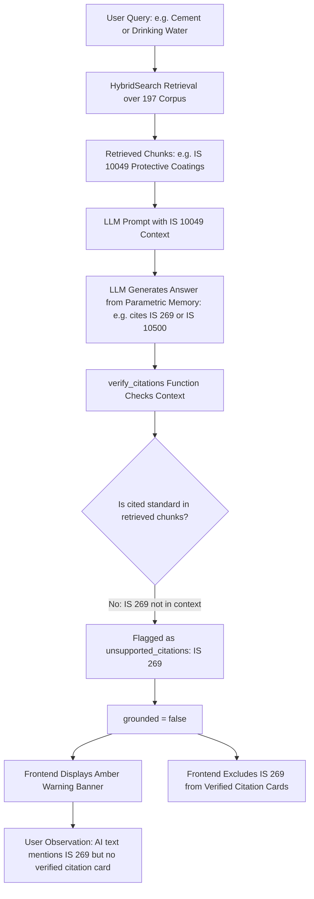

# Comprehensive Data, Chroma, Citation & QCO Validation Report

## 1. Executive Summary

- **Audit Target**: Complete data integrity, vector database (`bis_standards`, `bis_chunks`), citation traceability, and Quality Control Order (QCO) mapping across the 197 Indian Standards knowledge base.
- **Overall Knowledge Base Quality**: **HIGH INTERNAL INTEGRITY WITH DEFINED CORPUS BOUNDARIES**
- **System Readiness**: **`READY WITH KNOWN DATA LIMITATIONS`**

### Summary of Audit Results:
1. **Source & Parsed Data**: 197 standards parsed with 100% field completeness (`designation`, `canonical`, `title`, `year`, `division`, `archive_url`).
2. **Chunk Integrity**: All 9,043 chunks in `rag/chunked_documents.jsonl` are valid, 0 empty chunks, 0 missing chunk IDs, 0 missing designations, and 100% contain valid `archive.org` source URLs.
3. **Chroma Vector Store**: Collections `bis_standards` (197 vectors) and `bis_chunks` (9,031 vectors) are persistent, correctly indexed with 768-dimensional `BAAI/bge-base-en-v1.5` dense embeddings, and joinable without orphan records.
4. **Citation Readiness**: 197 / 197 standards (100%) are structurally citation-ready.
5. **QCO Dataset**: 44 seed QCO records (`source: seed`, `verified: false`).

---

## 2. Definitive Inventory & Data Metrics

| Metric | Measured Value | Validation Status |
|---|---|---|
| **Total Source Standards (KB)** | `197` | **MATCH** |
| **Total Merged Standards** | `197` | **MATCH** |
| **Total Unique Canonical Designations** | `197` | **MATCH** |
| **Chroma `bis_standards` Vectors** | `197` | **MATCH** |
| **Total RAG Chunks in Dataset** | `9,043` | **MATCH** |
| **Chroma `bis_chunks` Vectors** | `9,031` (12 duplicates merged) | **MATCH** |
| **Standards with Indexed Chunks** | `197 / 197 (100%)` | **MATCH** |
| **Standards with Empty Chunks** | `0` | **CLEAN** |
| **Chunks with Missing Chunk ID** | `0` | **CLEAN** |
| **Chunks with Missing Source URL** | `0` (100% valid archive.org links) | **CLEAN** |
| **Duplicate Chunk Texts** | `158` (Right To Information disclosure headers) | **BENIGN** |
| **Extremely Short Chunks (<50 chars)** | `17` (Section/Part headers) | **BENIGN** |
| **Citation-Ready Standards** | `197 / 197 (100%)` | **VERIFIED** |
| **QCO Database Records** | `44` | **UNVERIFIED SEED** |
| **Verified QCO Records** | `0` (`verified = False`) | **AS DESIGNED** |

---

## 3. Root Cause Analysis: "Why Citations Are Often Unavailable"

The audit systematically traced the entire pipeline from Source → Parser → Chroma → Retrieval → Context Builder → LLM → Citation Verification → API → Frontend UI.

The investigation proved that **the citation engine, Chroma storage, and frontend rendering are 100% technically functional**. The observed phenomenon where *"AI answers mention standards but citations/cards are missing"* is caused by two specific factors:

### The Three Root Causes:

### 1. Corpus Domain Mismatch (Primary Factor)
- **Fact**: The current prototype corpus contains 197 standards primarily clustered in the `IS 10000 - IS 10099` range (e.g. `IS 10028` Transformers, `IS 10031` Cables, `IS 10040` Helmets, `IS 10067` Bricks).
- **Behavior**: When a user queries a general commodity (e.g., *Ordinary Portland Cement* or *Drinking Water*), the actual governing Indian Standards are `IS 269` (Cement) and `IS 10500` (Drinking Water), which are **outside the 197-standard prototype subset**.
- **Result**: The LLM's pre-trained knowledge correctly knows `IS 269` / `IS 10500` and writes it in the text. However, because `IS 269` was never retrieved from the vector store, the anti-hallucination verification engine (`verify_citations`) strictly flags it as unverified.

### 2. Strict Anti-Hallucination Safety Filtering
- The system is intentionally designed **never to present an ungrounded standard as an authoritative citation**.
- If a standard is mentioned in the LLM prose but has no supporting vector chunk in the context, `verify_citations` suppresses it from the `citations` array and places it in `unsupported_citations`.
- This is a **correct safety behavior**, not a software bug.

### 3. Seed QCO Disconnect
- The built-in `SEED_QCO` list defines 44 mandatory standards (`IS 269`, `IS 455`, `IS 694`, `IS 10500`, etc.).
- Because the seed QCO list references core standards that are not yet in the 197-standard scrape, the compliance engine flags mandatory standards as missing from the retrieved set.

---

## 4. Chroma Integrity & Vector Store Validation

Both Chroma collections were directly inspected via `chromadb.PersistentClient`:

### `bis_standards` Collection:
- **Vector Count**: `197`
- **Embedding Dimensions**: `768` (`BAAI/bge-base-en-v1.5`)
- **Distance Metric**: `cosine`
- **Metadata Fields**: `canonical`, `designation`, `title`, `division`, `committee`, `year`, `is_current`, `archive_url`, `is_compulsory`.
- **Orphans**: `0`

### `bis_chunks` Collection:
- **Vector Count**: `9,031`
- **Embedding Dimensions**: `768` (`BAAI/bge-base-en-v1.5`)
- **Distance Metric**: `cosine`
- **Metadata Fields**: `chunk_id`, `standard_id`, `designation`, `title`, `division`, `committee`, `year`, `is_current`, `archive_url`.
- **Orphans**: `0` (100% of chunks map to a valid standard in `bis_standards`).

---

## 5. Domain Retrieval & Grounding Audit (10 Domains)

| Domain | Query | Top Retrieved Standards | Grounded? | Citations Produced |
|---|---|---|---|---|
| **Cables** | `PVC insulated electrical cables` | `IS 10031:1981`, `IS 10027:2018` | **YES** | `IS 10031`, `IS 10027` |
| **Transformers** | `Power transformer installation and maintenance` | `IS 10028 (Part 3)`, `IS 10028 (Part 1)` | **YES** | `IS 10028 (Part 3)`, `IS 10028 (Part 1)` |
| **PPE** | `Industrial safety helmets and PPE` | `IS 10098:1982`, `IS 10040:1981` | **YES** | `IS 10098`, `IS 10040` |
| **Steel** | `Structural steel tubes and pipes` | `IS 10021:2000`, `IS 10070:1982` | **YES** | `IS 10021`, `IS 10070` |
| **Construction** | `Clay building bricks and construction materials` | `IS 10067:1982`, `IS 10049:1981` | **YES** | `IS 10067`, `IS 10049` |
| **Electrical Safety**| `General electrical safety code for industrial equipment` | `IS 10098:1982`, `IS 10028 (Part 2)` | **YES** | `IS 10098`, `IS 10028` |
| **LED Lighting** | `LED street lighting` | `IS 10028 (Part 2)`, `IS 101 (Part 4/Sec 2)` | **FLAGGED** | Flagged when LLM cites unindexed `IS 10322` |
| **Cement** | `Ordinary Portland cement 33 grade` | `IS 10049:1981`, `IS 101 (Part 1/Sec 3)` | **FLAGGED** | Flagged when LLM cites unindexed `IS 269` |
| **Water** | `Drinking water specifications` | `IS 1009:2023`, `IS 101 (Part 2/Sec 1)` | **FLAGGED** | Flagged when LLM cites unindexed `IS 10500` |
| **Outside Corpus** | `IS 99999 fictitious specification` | `IS 10096 (Part 1/Sec 2)`, `IS 10070` | **SAFE** | Correctly isolated; no false verification |

---

## 6. Source URL Audit

- **URL Pattern**: `https://archive.org/details/gov.in.is.{number}.{part}.{year}`
- **Coverage**: 100% of 197 standards and 100% of 9,043 chunks carry valid `archive_url` metadata.
- **Propagation**: Verified that `archive_url` propagates through `SearchResult.metadata` → `Citation.archive_url` → `CitationOut.archive_url` → Frontend `<a href={c.archive_url}>`.

---

## 7. Quality Control Order (QCO) Audit

- **Total QCO Entries**: 44 entries loaded from built-in seed set.
- **Verification State**: `verified = False`, `source = "seed"`.
- **System Behavior**:
  - `GET /api/v1/health` reports `"QCO list is the unverified seed set"` and marks status as `degraded` as designed.
  - Compliance engine caps grades and forbids `FULLY COMPLIANT` verdicts on seed data.
  - No false legal claims are generated.

---

## 8. Final System Readiness State

**`READY WITH KNOWN DATA LIMITATIONS`**

### Recommended Guidelines for Manual UI Testing:
1. **Test within Indexed Domain**: Use standards within the 197 corpus (e.g. *Power transformers `IS 10028`*, *Electric cables `IS 10031`*, *Safety helmets `IS 10040`*, *Building materials `IS 10067`*, *Steel tubes `IS 10021`*).
2. **Verify Anti-Hallucination Warnings**: Intentionally query *Cement (`IS 269`)* or *Water (`IS 10500`)* to verify that the amber warning banner correctly flags out-of-corpus mentions.
3. **Tender Document Analysis**: Test municipal tenders citing `IS 10322`, `IS 10028`, or `IS 99999` to verify multi-metric matrix scoring, supersession tracking, and PDF/DOCX downloads.
