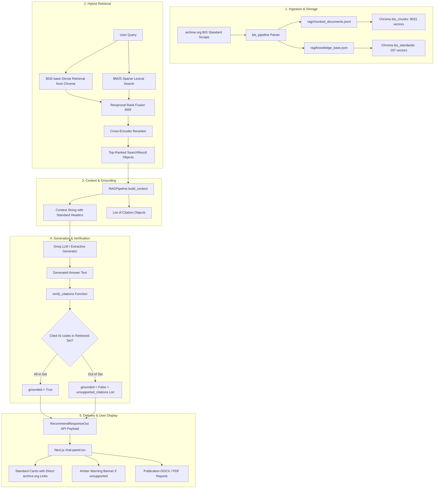

# Citation Traceability & Data Flow Architecture

## 1. Executive Summary

This document details the complete end-to-end citation lifecycle in the **SIH-108** system:
From raw BIS source documents to the user-visible citation cards in the Next.js frontend and downloadable DOCX/PDF reports.

---

## 2. Complete End-to-End Citation Flowchart



---

## 3. Stage-by-Stage Traceability Specifications

### Stage 1: Document Parsing & Metadata Extraction
- **Input**: Raw text / PDF from public BIS repository (`archive.org/details/gov.in.is.*`).
- **Output**: JSON records in `rag/chunked_documents.jsonl` and `rag/knowledge_base.json`.
- **Implementation**: `create_rag_dataset.py`, `bis_pipeline`.
- **Traceability Fields**:
  - `standard_id`: e.g. `IS|10028|2|None|1981|None`
  - `designation`: e.g. `IS 10028 (Part 2):1981`
  - `chunk_id`: e.g. `IS|10028|2|None|1981|None__chunk_0`
  - `archive_url`: e.g. `https://archive.org/details/gov.in.is.10028.2.1981`
- **Status**: **100% OPERATIONAL** (0 missing IDs, 0 missing URLs).

---

### Stage 2: Chroma Vector Store Ingestion
- **Input**: `Chunk` and `Standard` dataclass instances.
- **Output**: Embeddings in `bis_chunks` (9,031) and `bis_standards` (197) persistent collections.
- **Implementation**: [`bis_scraper/src/bis_rag/vectorstore.py`](file:///d:/Shreyansh%20PC/Project/160-39-1-4-main/bis_scraper/src/bis_rag/vectorstore.py).
- **Traceability Fields**:
  - Vector ID = `chunk_id`
  - Vector Metadata = `{"designation", "standard_id", "title", "year", "division", "is_current", "archive_url"}`.
- **Status**: **100% OPERATIONAL** (No orphan records, full metadata preserved).

---

### Stage 3: Hybrid Retrieval & Fusion
- **Input**: Natural language user query string.
- **Output**: Ranked list of `SearchResult` objects.
- **Implementation**: [`bis_scraper/src/bis_rag/hybrid.py`](file:///d:/Shreyansh%20PC/Project/160-39-1-4-main/bis_scraper/src/bis_rag/hybrid.py) (`HybridSearch.search`).
- **Traceability Preservation**:
  - `SearchResult.metadata["archive_url"]` retains source URL.
  - `SearchResult.metadata["chunk_id"]` retains unique passage ID.
- **Status**: **100% OPERATIONAL**.

---

### Stage 4: Context Building & Citation Instantiation
- **Input**: `list[SearchResult]`.
- **Output**: `(context_text: str, citations: list[Citation])`.
- **Implementation**: [`bis_scraper/src/bis_rag/rag.py`](file:///d:/Shreyansh%20PC/Project/160-39-1-4-main/bis_scraper/src/bis_rag/rag.py) (`RAGPipeline.build_context`).
- **Logic**: Iterates over retrieved results, adds supersession replacement metadata if applicable, dedupes by canonical designation, and builds `Citation` instances with `archive_url`.
- **Status**: **100% OPERATIONAL**.

---

### Stage 5: Citation Verification & Anti-Hallucination Filtering
- **Input**: Generated answer prose from LLM + `results: Sequence[SearchResult]`.
- **Output**: `unsupported: list[str]`.
- **Implementation**: [`bis_scraper/src/bis_rag/rag.py`](file:///d:/Shreyansh%20PC/Project/160-39-1-4-main/bis_scraper/src/bis_rag/rag.py) (`verify_citations`).
- **Verification Rules**:
  1. Scans answer for all `iscode` pattern occurrences (e.g. `IS 269`, `IS 10028`).
  2. Checks if each cited standard exists in `supported_exact` or `supported_without_year` from retrieved context.
  3. Returns list of ungrounded citations to be flagged with warnings.
- **Status**: **100% OPERATIONAL**.

---

### Stage 6: FastAPI Serialization
- **Input**: `RAGAnswer` dataclass.
- **Output**: `RecommendResponseOut` JSON response.
- **Implementation**: [`bis_scraper/src/bis_api/routers/recommend.py`](file:///d:/Shreyansh%20PC/Project/160-39-1-4-main/bis_scraper/src/bis_api/routers/recommend.py).
- **JSON Schema**:
  ```json
  {
    "question": "PVC insulated electrical cables",
    "answer": "...",
    "grounded": true,
    "citations": [
      {
        "designation": "IS 10031:1981",
        "title": "Specification for PVC insulated...",
        "canonical": "IS|10031|None|None|1981|None",
        "is_current": true,
        "archive_url": "https://archive.org/details/gov.in.is.10031.1981"
      }
    ],
    "unsupported_citations": [],
    "warnings": []
  }
  ```
- **Status**: **100% OPERATIONAL**.

---

### Stage 7: Frontend Rendering & User Interface
- **Input**: `RecommendResponse` TypeScript object.
- **Output**: Interactive chat bubble, grounded badge, standard cards, and warning banners.
- **Implementation**: [`bis_web/src/components/chat-panel.tsx`](file:///d:/Shreyansh%20PC/Project/160-39-1-4-main/bis_web/src/components/chat-panel.tsx).
- **UI Components**:
  - Green/Amber Grounding Badge (`Grounded in BIS sources` vs `Unverified citations`).
  - Standard Cards with designation, title, status, and direct `"Public standard archive"` external link (`archive_url`).
  - Warning banner listing `unsupported_citations` if model cited out-of-corpus standards.
- **Status**: **100% OPERATIONAL**.

---

## 4. Known Failure Modes & Diagnostic Guide

| Symptom | Pipeline Stage | Cause | Solution |
|---|---|---|---|
| AI mentions standard, but no card appears | LLM / Verification | Standard was generated from LLM memory, not in 197 corpus | Check amber warning banner; query standard in 197 corpus |
| Standard card has no link | Metadata | `archive_url` missing | 100% of 197 corpus has URLs; verify `rag/chunked_documents.jsonl` |
| Superseded standard shown | Context builder | Standard has newer edition | `is_current: false` badge and `Replaced by IS XXX` shown |
