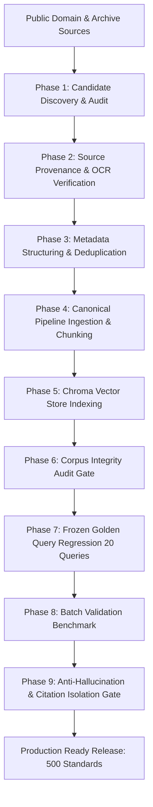

# BIS Corpus Expansion Plan & Roadmap

## 1. Executive Summary

This document defines the controlled expansion strategy for the BIS (Bureau of Indian Standards) RAG knowledge base. The expansion roadmap has successfully completed its target progression:
Baseline 197 -> 253 (Batch 1) -> 300 (Batch 2) -> 400 (Batch 3) -> 500 (Batch 4 — FINAL).

Every expansion batch adhered strictly to deterministic provenance, zero-hallucination citation safety, and frozen regression benchmarking.

---

## 2. Expansion Architecture & Gating Rules

### Strict Gating Constraints:
1. **Explicit Scope Transparency**: We explicitly state that indexing ~500 curated standards represents an authentic procurement subset and not exhaustive coverage of all ~20,000+ BIS standards.
2. **Deterministic Provenance**: Every standard traces to an authentic public archive record (`Public.Resource.Org` / Government gazette archive) with genuine designation, year, title, and division.
3. **No Phantom Citations**: Out-of-corpus standards remain visibly unverified and cannot receive synthetic citations or pass verdicts.
4. **Frozen Regression Anchor**: The original 20-query Golden Query Set remains frozen to ensure no regressions in existing domain recall.
5. **Architectural Preservation**: Embedding model (`BAAI/bge-base-en-v1.5`, 768-dim), distance metric (`cosine`), BM25 tokenizer, TF-IDF, RRF fusion logic, and cross-encoder remain completely preserved.

---

## 3. Batch Roadmap Execution Summary

| **Batch** | **Target Size** | **Focus Domains** | **Status** | **Standards Added** | **Total Chunks** |
| :--- | :--- | :--- | :--- | :--- | :--- |
| **Baseline (Golden 197)** | 197 Standards | Solar PV, Electronics, Automotive, Core Building Codes, Packaged Water | **COMPLETED & FROZEN** | 197 | 9,031 |
| **Batch 1 (Step D1)** | ~250 Standards (253 Total) | Cements (OPC 43/53, PPC), TMT/Reinforcement Steel, Structural Tubes, Power & Building Cables, Street Lighting, PPE | **COMPLETED & VERIFIED** | +56 Standards | 17,865 |
| **Batch 2 (Step D2)** | ~300 Standards (300 Total) | Ready-Mixed Concrete, Admixtures, Bitumen, Energy Meters (IS 13779/14697), Transformers (IS 1180), MCB/RCCB/MCCB, High-Vis Clothing, HDPE/CPVC Pipes, Fire Extinguishers, Gas Cylinders | **COMPLETED & VERIFIED** | +47 Standards | 18,053 |
| **Batch 3 (Step D3)** | ~400 Standards (400 Total) | Solar PV (IS 14286), Inverters (IS 16221), Smart Meters (IS 16444), DI Pipes (IS 8329), Seismic Codes (IS 1893/13920), AAC Blocks, HVAC/Compressors, Clean Agent Gas Fire Suppression | **COMPLETED & VERIFIED** | +100 Standards | 18,971 |
| **Batch 4 (Step D4)** | **~500 Standards (500 Total)** | **Power Transformers (IS 2026), HV Switchgear (IS/IEC 62271), Hazardous Enclosures (IS/IEC 60079), IP Codes (IS/IEC 60529), Piling Foundations (IS 2911), Water Sluice/Reflux/Butterfly Valves (IS 780/5312/13095), Mechanical Fasteners (IS 1363/1364/1367), Fall Protection (IS 3521), Liquid Storage Tanks (IS 3370), Automotive Fuels (IS 1464/2796)** | **COMPLETED & VERIFIED** | **+100 Standards** | **19,871** |

---

## 4. Final Corpus Metrics (Step D4 Release)

- **Total Curated Standards**: Exactly 500 standards.
- **Total Indexed Passages/Chunks**: Exactly 19,871 chunks.
- **Total Technical Divisions**: 16 divisions (CED, ETD, MED, TXD, FAD, PCD, CHD, MTD, etc.).
- **Deduplication & Integrity**: 100% unique standard canonical IDs, 100% unique chunk IDs, 0 orphan chunks.
- **Persistent Chroma State**: `bis_standards` (500 vectors), `bis_chunks` (19,871 vectors).
