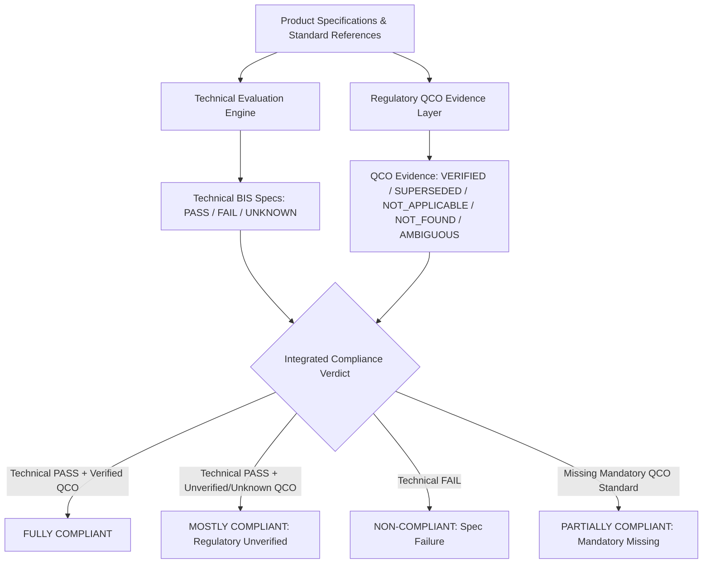

# Document 33: QCO Verified Evidence Integration & Validation Report

## 1. Executive Summary

Following official Gazette verification in Step QCO-2, the structured evidence dataset [`data/qco_verified_database.json`](file:///d:/Shreyansh%20PC/Project/160-39-1-4-main/data/qco_verified_database.json) has been integrated into the BIS compliance and tender assessment engines.

The integration enforces explicit state tracking across all 44 original seed candidates, establishing strict regulatory boundaries and preventing false authoritative claims while surfacing full statutory provenance for all verified Quality Control Orders.

### Candidate Distribution Summary (44 Candidates)
| Category | Count | Regulatory Impact | Status Code |
| :--- | :---: | :--- | :--- |
| **VERIFIED** | **33** | Authoritative statutory QCO enforcement enabled | `VERIFIED` |
| **SUPERSEDED / CHANGED** | **2** | Historical standard amalgamated (IS 8112/IS 12269 -> IS 269:2015) | `SUPERSEDED_OR_CHANGED` |
| **NOT APPLICABLE** | **6** | Voluntary/component/test standard; no statutory product QCO | `NOT_APPLICABLE` |
| **NOT FOUND** | **2** | No official Gazette QCO notification exists in active enforcement | `NOT_FOUND` |
| **AMBIGUOUS** | **1** | Scope boundary / schedule transition requires clarification (IS 1536) | `AMBIGUOUS` |
| **SEED UNVERIFIED** | **0** | All 44 candidates have received explicit statutory verification | `SEED_UNVERIFIED` |
| **Total Evaluated** | **44** | **100% Accounted For with Level 1 / Level 2 Statutory Evidence** | — |

---

## 2. Statutory Authority Rules

To ensure legal accuracy and prevent deceptive compliance claims, the compliance engine enforces the following non-negotiable rules:

1. **Authoritative Determination Rule**:
   - Only records with `evidence_state == "VERIFIED"` and `is_effective == True` (i.e. `effective_date <= current_date`) may produce an authoritative regulatory mandatory determination.
   - Non-verified states (`SEED_UNVERIFIED`, `NOT_FOUND`, `AMBIGUOUS`, `SUPERSEDED_OR_CHANGED`, `NOT_APPLICABLE`) **CANNOT** produce an authoritative QCO PASS.

2. **Non-Applicability Grounding**:
   - `NOT_APPLICABLE` explicitly supports non-applicability findings (e.g. IS 383 for aggregates, IS 14700 for EMC testing), preventing false claims of regulatory non-compliance for voluntary standards.

3. **Superseded Standard Guardrails**:
   - For amalgamated cement standards (`IS 8112` and `IS 12269`), the system explicitly flags that the regulatory designation transitioned to `IS 269:2015` and does not silently treat old designations as currently active standalone QCOs.

4. **Effective Date Awareness**:
   - Future commencement dates are evaluated dynamically. A QCO with a future effective date does not produce mandatory enforcement until its commencement date arrives.

---

## 3. Separation of Technical Compliance vs Regulatory Applicability

The compliance engine maintains a strict separation between engineering conformity and statutory QCO enforcement:



- **Technical PASS + QCO UNVERIFIED/UNKNOWN**: Grade is capped at `MOSTLY COMPLIANT` with explicit notice:
  > *"QCO evidence for one or more standards is unverified, non-authoritative, or seed data; a fully-compliant verdict requires verified authoritative QCO evidence."*
- **Technical PASS + QCO VERIFIED**: Awards `FULLY COMPLIANT` only when all required mandatory standards are present, current, and backed by verified Gazette evidence.

---

## 4. Frontend & Report UI Representation

### UI Badges
The frontend matrix and compliance views render distinctive badges for all 6 evidence states:

| State | Badge Text | Visual Style | Meaning |
| :--- | :--- | :--- | :--- |
| `VERIFIED` | `✓ Verified QCO evidence` | Green / Success | Backed by official Gazette notification and active enforcement |
| `SUPERSEDED_OR_CHANGED` | `↻ Regulatory status changed` | Amber / Warning | Historical standard superseded or amalgamated |
| `NOT_APPLICABLE` | `○ QCO not applicable` | Slate / Outline | Confirmed voluntary / test standard not under product QCO |
| `AMBIGUOUS` | `⚠ QCO applicability ambiguous` | Amber / Secondary | Scope boundary requires Gazette confirmation |
| `NOT_FOUND` | `⚠ No verified QCO evidence found` | Slate / Secondary | No Gazette QCO notification found in active records |
| `SEED_UNVERIFIED` | `⚠ Unverified QCO seed` | Amber / Secondary | Bootstrap seed entry without Gazette proof |

### Rich Statutory Metadata Exposer
For each verified QCO, the UI and generated reports (DOCX/PDF) expose:
- **QCO Title**: e.g., *Cement (Quality Control) Order, 2003 / 2024*
- **Notification Number**: e.g., *S.O. 191(E) / S.O. 3133(E)*
- **Issuing Ministry**: e.g., *Department for Promotion of Industry and Internal Trade (DPIIT), Ministry of Commerce and Industry*
- **Effective Date**: e.g., *2003-02-17*
- **Official Source**: Gazette publication citation & BIS portal reference

---

## 5. Health Endpoint Semantics

The `/health` endpoint (`Services.health()`) has been updated to report exact QCO breakdown semantics:
```json
{
  "qco": {
    "entries": 44,
    "source": "verified_db",
    "verified": true,
    "verified_count": 33,
    "superseded_count": 2,
    "not_applicable_count": 6,
    "not_found_count": 2,
    "ambiguous_count": 1,
    "seed_unverified_count": 0,
    "coverage_note": "This QCO layer contains a verified subset of identified regulatory mappings. It is not a claim of complete or exhaustive QCO coverage across India."
  }
}
```

---

## 6. Safety & Integration Test Suite Summary

A comprehensive test suite ([`tests/test_qco_verified_integration.py`](file:///d:/Shreyansh%20PC/Project/160-39-1-4-main/bis_scraper/tests/test_qco_verified_integration.py)) validates all safety requirements:

1. **Test A (`test_verified_qco_authoritative_allowed`)**: Verifies 33 records carry authoritative status, Gazette notification numbers, and issuing ministries.
2. **Test B (`test_seed_unverified_cannot_produce_authoritative_pass`)**: Confirms seed unverified entries cannot produce authoritative PASS or FULLY COMPLIANT.
3. **Test C (`test_not_found_cannot_produce_authoritative_pass`)**: Confirms IS 1077 and IS 4707 remain non-authoritative.
4. **Test D (`test_ambiguous_cannot_produce_authoritative_pass`)**: Confirms IS 1536 is treated with explicit ambiguity.
5. **Test E (`test_superseded_or_changed_handling`)**: Verifies IS 8112 and IS 12269 reference IS 269:2015 amalgamation.
6. **Test F (`test_not_applicable_correctly_represented`)**: Verifies IS 383, IS 14700, IS 5120, IS 1479, IS 7215, IS 121 are marked NOT_APPLICABLE.
7. **Test G (`test_effective_date_handling`)**: Verifies future commencement dates are held non-authoritative until effective.
8. **Test H (`test_qco_source_citation_and_fields`)**: Validates complete statutory provenance fields.
9. **Test I (`test_product_is_qco_relationship`)**: Validates product description to IS to QCO resolution.
10. **Test J (`test_technical_pass_with_unverified_qco_capped`)**: Confirms technical specification PASS does not produce FULLY COMPLIANT when QCO evidence is unverified.

---

## 7. System Boundaries and Explicit Limitations

> [!IMPORTANT]
> **Mandatory Regulatory Boundary**:
> "This QCO layer contains a verified subset of identified regulatory mappings. It is not a claim of complete or exhaustive QCO coverage across India."
